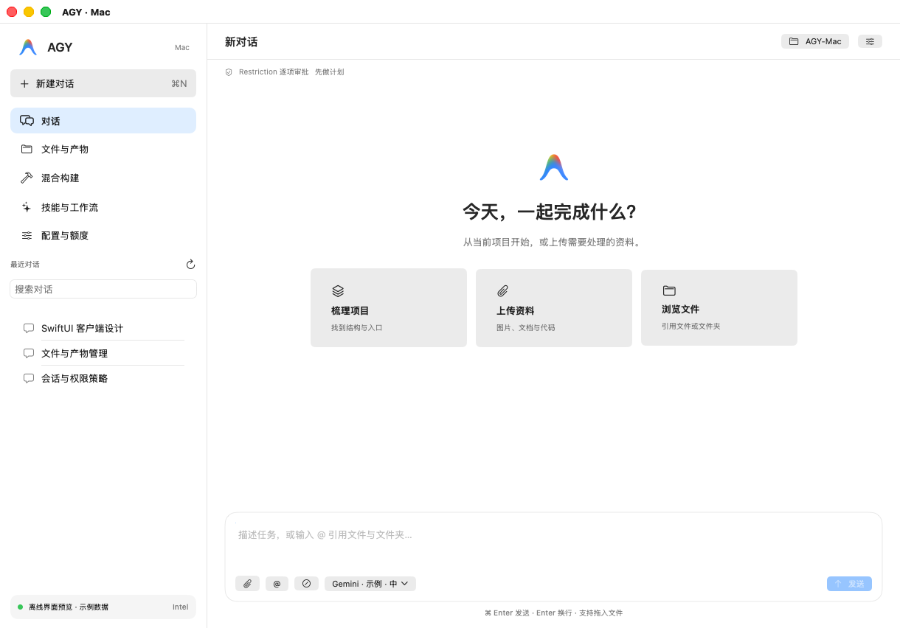
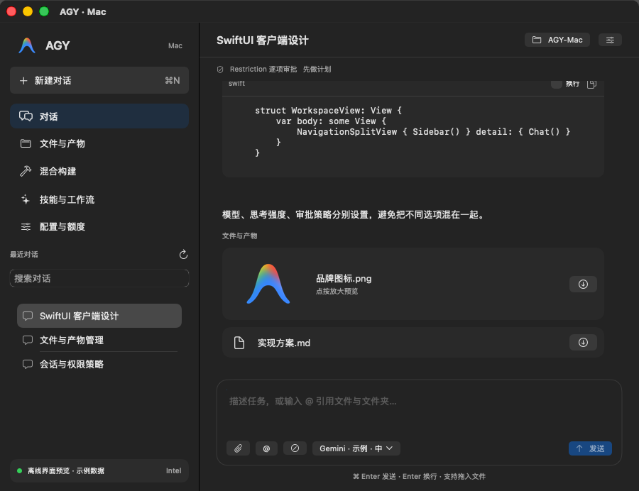
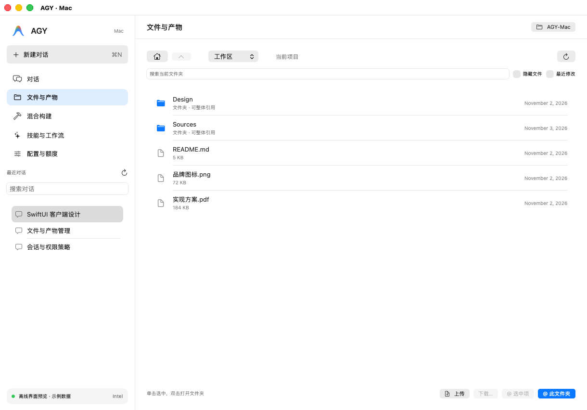
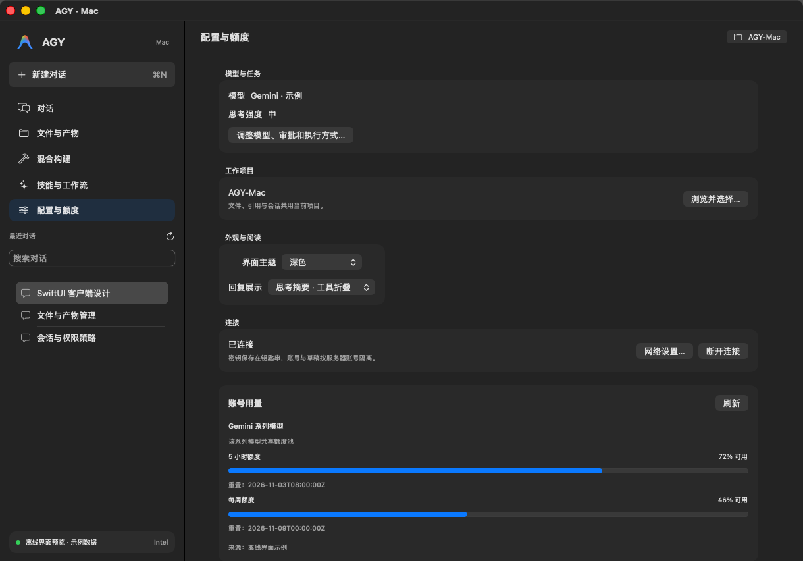

# 原生界面人工检查

已查看 [Intel Tahoe Actions 41563466661](https://github.com/ddyec/AGY-Mac/actions/runs/41563466661) 的实际 SwiftUI/AppKit 渲染图，源提交 `0d94a2c`。18 个取图场景包含浅/深色登录、欢迎页、聊天、模型弹窗、文件、构建、设置、技能，以及窄窗口和审批/队列。

首轮发现侧栏空白、深色顶栏白块、页标题重复和输入框缺少提示。改为明确的 HSplitView 原生分栏与背景、统一内容顶栏、补充输入提示后，复查下列图片：侧栏条目与会话可见，顶栏颜色一致；900 像素窄窗口的代码和产物卡片保持在内容区域内。文件与模型弹窗的操作对齐正常。

这些是已显示窗口通过 AppKit `cacheDisplay` 获取的原生视图图像。runner 的 WindowServer 抓屏不可用，不能据此保证系统玻璃、阴影与用户桌面完全一致。截图使用明确标注的离线示例数据，不代表真实任务已执行。完整图片与捕获清单随 Release 提供；最终运行包的构建链接见 Release。

## 欢迎页 · 浅色

## 窄窗口聊天 · 深色

## 文件与产物

## 配置与额度

